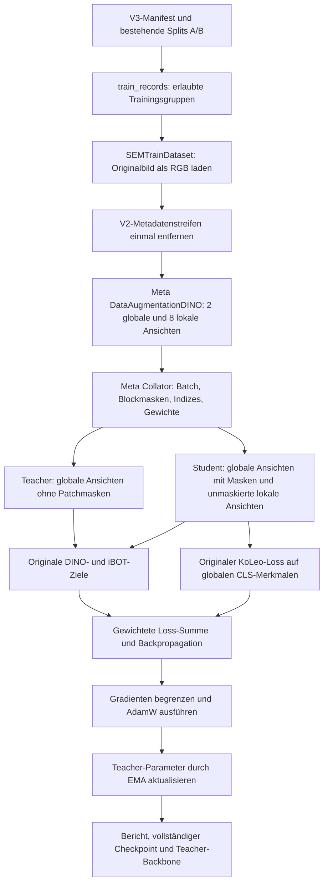
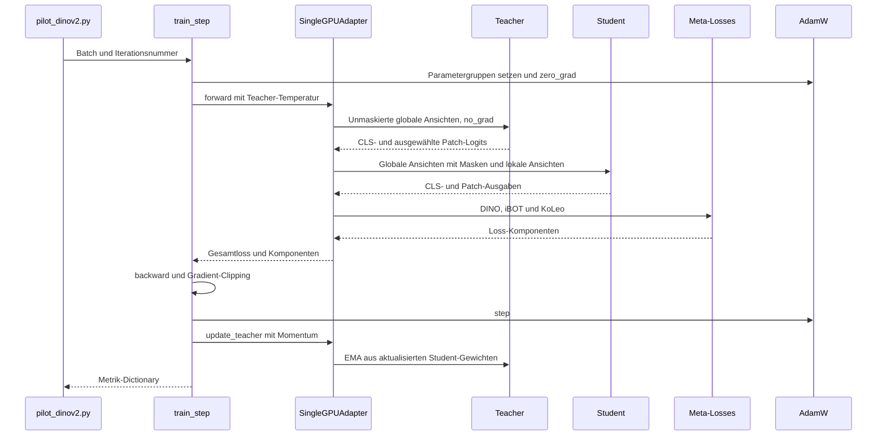

# Die SEM-SSL-Pipeline: Ablauf, Architektur und Aufgaben der Dateien

**Stand: 11. November 2026.** Diese Dokumentation beschreibt den vorhandenen Code
und die gespeicherten Testberichte. Sie erklärt die selbstüberwachte
Nachtrainingspipeline für SEM-Bilder sowie ihre Schnittstelle zur bestehenden
Klassifikation und Segmentierung.

Der aktuelle Einstieg ist ein begrenzter Pilot mit **Metas originalen
DINOv2-Komponenten**. Der native Adapter hat auf einer A100 80 GB drei synthetische
Trainingsschritte mit CUDA/BF16 bestanden. Ein vollständiges SEM-Post-Training und
ein Nachweis besserer Repräsentationen stehen noch aus.

Die kürzere Betriebsanleitung mit Installationshistorie und allen Abweichungen
steht in [sem_ssl_pilot.md](sem_ssl_pilot.md). Dieses Dokument erklärt ausführlich,
wie die einzelnen Teile zusammenarbeiten.

## 1. Was die Pipeline lernen soll

Ausgangspunkt ist ein bereits vortrainierter DINOv2-ViT-S/14. Er soll durch
unbeschriftete SEM-Bilder Repräsentationen lernen, die zu unserer Bilddomäne
passen. Dafür werden seine Backbone-Gewichte weitertrainiert.

Das Ziel einer Trainingseinheit kommt aus einem zweiten Netz, dem **Teacher**.
Dieser verarbeitet unmaskierte Bildansichten. Der **Student** verarbeitet andere
Ansichten und teilweise maskierte Versionen. Er soll die Ausgaben des Teachers
vorhersagen. Der Teacher wird anschließend durch einen gleitenden Mittelwert
der Student-Gewichte aktualisiert.

Drei originale Meta-Ziele wirken zusammen:

| Ziel | Was wird verglichen? | Aufgabe |
| --- | --- | --- |
| DINO | Globale CLS-Repräsentationen verschiedener Ansichten desselben Bildes | Übereinstimmung auf Bildebene lernen |
| iBOT | Student- und Teacher-Ausgaben für ausgewählte maskierte Patchpositionen | Lokale Repräsentationen aus Bildkontext lernen |
| KoLeo | Globale Student-Repräsentationen verschiedener Bilder innerhalb einer Ansicht | Eine zu starke Konzentration der Merkmale vermeiden |

Die vorhandenen Materialklassen und Segmentierungsmasken liefern dabei keine
Trainingsziele. Klassenlabels werden erst bei späteren Downstream-Aufgaben
gebraucht. Die 65.536 Ausgänge des SSL-Heads sind **Prototypen**, keine 65.536
Materialklassen. Der Backbone liefert weiterhin Merkmale mit 384 Dimensionen.

## 2. Wo Code, Umgebung und Daten liegen

| Bestandteil | Aktueller Ort |
| --- | --- |
| Unser Git-Projekt | `/path/to/nffa-sem-dinov2` |
| Metas externer Checkout | `/path/to/workspace/external/dinov2` |
| Verwendete Conda-Umgebung | `sem-gpu` |
| SEM-Originalbilder, Standard | `/path/to/datasets/nffa_sem_100` |
| Kuratiertes V3-Manifest | `outputs/dataset_v3/manifest.csv` |
| Bestehende Splits | `outputs/dataset_v3/splits/` |
| Pilotläufe und Checkpoints | `outputs/sem_ssl_checks/` |
| Paketinventare | `outputs/environment_audits/sem-gpu_2026-11-11/` |

Bei einem gemeinsamen Dateisystem greifen Workstation und GPU-Rechner auf dasselbe Datenverzeichnis zu. Deshalb sind
Umgebung, Quellcode, Daten und Ergebnisse auf beiden Rechnern verfügbar. Die GPU
steht auf dem A100; ein Python-Prozess auf der Workstation erhält durch das
gemeinsame Dateisystem keinen Zugriff auf diese GPU.

### 2.1 Die feste Meta-Version

[dinov2-upstream.json](../dinov2-upstream.json) enthält:

```text
Repository: https://github.com/facebookresearch/dinov2.git
Commit:     7764ea0f912e53c92e82eb78a2a1631e92725fc8
Backbone:   dinov2_vits14_pretrain.pth
SHA-256:    b938bf1bc15cd2ec0feacfe3a1bb553fe8ea9ca46a7e1d8d00217f29aef60cd9
```

Die Gewichte liegen aktuell unter
`/path/to/workspace/cache/torch/hub/checkpoints/dinov2_vits14_pretrain.pth`.
Eine frische Datei vom offiziellen Meta-Download wurde mit dem vorhandenen Cache
verglichen; die Prüfsummen stimmen überein.

### 2.2 Die bestehende Python-Umgebung

Die aktuelle Umgebung verwendet PyTorch `2.13.0+cu126`, torchvision
`0.28.0+cu126`, CUDA-Pakete für 12.6, Python 3.11.17 und NumPy 2.4.6.
Die Vorbereitung hat acht fehlende leichte Pakete ergänzt. Die 100 zuvor
vorhandenen Python-Distributionen blieben bei Versionen und erfassten
Metadaten/RECORD-Hashes unverändert; `pip check` bestand vorher und nachher.

Die genaue Ergänzungsliste steht in
[requirements-micronet-ssl.txt](../environments/requirements-micronet-ssl.txt).
Eine neue Conda-Umgebung gehört nicht zum aktuellen Ablauf.

## 3. Dateilandkarte unseres SSL-Codes

### 3.1 Die vier Dateien unter `src/ssl/`

| Datei | Verantwortung | Wichtigste Schnittstellen |
| --- | --- | --- |
| [src/ssl/__init__.py](../src/ssl/__init__.py) | Kennzeichnet das Python-Paket. Enthält keine Trainingslogik. | Paketimport `src.ssl` |
| [src/ssl/upstream.py](../src/ssl/upstream.py) | Findet und prüft den externen Meta-Checkout; verhindert die Verwendung einer anderen Version oder eines anderen bereits importierten Pakets. | `PIN`, `ROOT`, `checkout_path()`, `activate()` |
| [src/ssl/data.py](../src/ssl/data.py) | Wählt erlaubte Trainingsbilder, lädt SEM-Originalbilder, setzt die V2-Metadatenkorrektur vor Metas Augmentation und baut den originalen Collator. | `train_records()`, `SEMTrainDataset`, `augmentation_and_collate()`, `seed_worker()`, `sha256()` |
| [src/ssl/adapter.py](../src/ssl/adapter.py) | Verbindet originale Student-/Teacher-Komponenten und Losses für ein einzelnes Gerät; steuert Optimierung und Teacher-EMA. | `load_config()`, `SingleGPUAdapter`, `schedules()`, `train_step()` |

### 3.2 Start-, Prüf- und Hilfsskripte

| Datei | Wann wird sie verwendet? | Was sie macht |
| --- | --- | --- |
| [scripts/setup_dinov2_external.py](../scripts/setup_dinov2_external.py) | Beim Einrichten eines noch fehlenden Checkouts | Klont Meta außerhalb unseres Repositories, checkt den festen Commit im Detached-HEAD-Zustand aus und prüft ihn. Verweigert Änderungen an einem verschmutzten Checkout. |
| [scripts/inventory_ssl_environment.py](../scripts/inventory_ssl_environment.py) | Vor und nach Paketänderungen | Sichert pip-/Conda-Inventare, Python-/Hostdaten, Conda-Metadaten, History und Distribution-Metadaten. Installiert selbst nichts. |
| [scripts/probe_dinov2_official.py](../scripts/probe_dinov2_official.py) | Zuerst beim GPU-Smoke-Test | Versucht Metas vollständige `SSLMetaArch` und `do_train` unverändert auszuführen; schreibt auch bei einem Fehler einen Bericht. Erlaubt maximal drei Schritte. |
| [scripts/pilot_dinov2.py](../scripts/pilot_dinov2.py) | Für den nativen Pilotlauf | Verarbeitet CLI-Argumente, prüft Umgebung und Gewichte, erstellt Dataset/DataLoader und Adapter, führt 2–20 Schritte aus und speichert Ergebnisse. |
| [scripts/verify_dinov2_checkpoint.py](../scripts/verify_dinov2_checkpoint.py) | Nach einem erfolgreichen nativen Pilotlauf | Lädt den vollständigen Zustand erneut, prüft Modell-/Optimizer-Zustände und vergleicht den exportierten Backbone mit dem gespeicherten Teacher. |
| [scripts/smoke_dinov2_a100.sh](../scripts/smoke_dinov2_a100.sh) | Als einzelner Startbefehl auf dem A100 | Prüft den Hostnamen, startet zuerst den offiziellen Test und bei dessen Scheitern einen dreischrittigen synthetischen CUDA/BF16-Pilot samt Checkpoint-Prüfung. |

### 3.3 Konfiguration und gemeinsame Hilfsdateien

| Datei | Aufgabe |
| --- | --- |
| [configs/sem_ssl_pilot.yaml](../configs/sem_ssl_pilot.yaml) | Unsere expliziten Pilot-Einstellungen; werden über Metas Standardkonfiguration gelegt. |
| [dinov2-upstream.json](../dinov2-upstream.json) | Commit, Repository-Adresse, Standardpfad und Identität der freigegebenen Backbone-Gewichte. |
| [src/config.py](../src/config.py) | Definiert `DATASET_ROOT`; über `NFFA_SEM_ROOT` auf einen anderen Bildordner umstellbar. |
| [src/preprocessing_v2.py](../src/preprocessing_v2.py) | Enthält die bestehende Erkennung und Entfernung des SEM-Metadatenstreifens. SSL verwendet daraus `crop_metadata_strip()`. |
| [environments/requirements-micronet-ssl.txt](../environments/requirements-micronet-ssl.txt) | Dokumentiert die acht ergänzten leichten Pakete. Vor einer erneuten Installation immer prüfen, welche davon wirklich fehlen. |
| [tests/test_ssl_pilot.py](../tests/test_ssl_pilot.py) | Prüft originale Komponenten, Loss-/Gradientenvergleich, Teacher/EMA, Zentren, Zeitpläne, Datenfilter und Versionsschutz. |

Die Dateien `environments/dinov2-a100.yml` und
`environments/requirements-dinov2-cpu.txt` dokumentieren frühere beziehungsweise
historische Umgebungsvarianten. Für den aktuellen Ablauf gilt `sem-gpu`.

## 4. Welche Komponenten direkt von Meta kommen

Die folgenden Pfade sind relativ zur Wurzel des externen Checkouts. Die
Verknüpfungen führen jeweils zur festgelegten Upstream-Version.

| Originaldatei | Verwendung bei uns |
| --- | --- |
| [dinov2/hub/backbones.py](https://github.com/facebookresearch/dinov2/blob/7764ea0f912e53c92e82eb78a2a1631e92725fc8/dinov2/hub/backbones.py) | `dinov2_vits14(pretrained=False)` baut die originale Backbone-Architektur. Die kontrollierten Gewichte laden wir anschließend explizit. |
| [dinov2/models/vision_transformer.py](https://github.com/facebookresearch/dinov2/blob/7764ea0f912e53c92e82eb78a2a1631e92725fc8/dinov2/models/vision_transformer.py) | Transformer, Patch-Embedding, Mask-Token, Positionsinterpolation sowie CLS- und Patch-Ausgaben. |
| [dinov2/layers/dino_head.py](https://github.com/facebookresearch/dinov2/blob/7764ea0f912e53c92e82eb78a2a1631e92725fc8/dinov2/layers/dino_head.py) | Originaler `DINOHead` mit MLP, Merkmalsnormalisierung und Weight-Normalization der letzten Schicht. |
| [dinov2/loss/dino_clstoken_loss.py](https://github.com/facebookresearch/dinov2/blob/7764ea0f912e53c92e82eb78a2a1631e92725fc8/dinov2/loss/dino_clstoken_loss.py) | `DINOLoss` sowie Teacher-Softmax und Zentrierung. |
| [dinov2/loss/ibot_patch_loss.py](https://github.com/facebookresearch/dinov2/blob/7764ea0f912e53c92e82eb78a2a1631e92725fc8/dinov2/loss/ibot_patch_loss.py) | `iBOTPatchLoss`, Maskengewichtung und eigenes Teacher-Zentrum. Enthält bereits Metas PyTorch-Alternative zur xFormers-Cross-Entropy. |
| [dinov2/loss/koleo_loss.py](https://github.com/facebookresearch/dinov2/blob/7764ea0f912e53c92e82eb78a2a1631e92725fc8/dinov2/loss/koleo_loss.py) | Originale KoLeo-Regularisierung. |
| [dinov2/data/augmentations.py](https://github.com/facebookresearch/dinov2/blob/7764ea0f912e53c92e82eb78a2a1631e92725fc8/dinov2/data/augmentations.py) | `DataAugmentationDINO` erstellt globale und lokale Ansichten. |
| [dinov2/data/masking.py](https://github.com/facebookresearch/dinov2/blob/7764ea0f912e53c92e82eb78a2a1631e92725fc8/dinov2/data/masking.py) | `MaskingGenerator` erzeugt räumliche Blockmasken auf dem Patchraster. |
| [dinov2/data/collate.py](https://github.com/facebookresearch/dinov2/blob/7764ea0f912e53c92e82eb78a2a1631e92725fc8/dinov2/data/collate.py) | `collate_data_and_cast` stapelt Ansichten und erzeugt Maskenindizes und Gewichte. |
| [dinov2/utils/param_groups.py](https://github.com/facebookresearch/dinov2/blob/7764ea0f912e53c92e82eb78a2a1631e92725fc8/dinov2/utils/param_groups.py) | Gewichtszerfall und Lernratenfaktoren für einzelne Parametergruppen. |
| [dinov2/utils/utils.py](https://github.com/facebookresearch/dinov2/blob/7764ea0f912e53c92e82eb78a2a1631e92725fc8/dinov2/utils/utils.py) | Originaler `CosineScheduler`. |
| [dinov2/train/ssl_meta_arch.py](https://github.com/facebookresearch/dinov2/blob/7764ea0f912e53c92e82eb78a2a1631e92725fc8/dinov2/train/ssl_meta_arch.py) und [dinov2/train/train.py](https://github.com/facebookresearch/dinov2/blob/7764ea0f912e53c92e82eb78a2a1631e92725fc8/dinov2/train/train.py) | Vollständige offizielle Trainingsimplementierung für den ersten Test und Referenz für das Zusammenschalten der Komponenten. |

Unser Adapter kopiert keine mathematischen Loss-Implementierungen. Er bestimmt,
welche Ansichten und Tokens in diese Originalfunktionen eingehen, wie ihre
Ergebnisse gewichtet werden und wann Optimizer und EMA laufen.

## 5. Datenfluss vom Bild bis zum exportierten Encoder



Im synthetischen Modus ersetzt `torchvision.datasets.FakeData` die Schritte
Manifestauswahl, SEM-Dateizugriff und Metadatenkorrektur. Die DINO-Augmentation,
Maskierung, Modelle, Losses und Optimierung werden weiterhin ausgeführt.
Ein bestandener synthetischer Test prüft deshalb noch nicht die reale SEM-Laderoute.

## 6. Auswahl und Vorverarbeitung der SEM-Bilder

### 6.1 Manifest und Splits haben verschiedene Aufgaben

Das Manifest beschreibt die kuratierten Bilder. Die Splitdateien bestimmen,
welche Bilder für Training, Validation oder Test vorgesehen sind.

Für `train_records()` sind im Manifest `image_id` und `included` relevant.
`crop_mode` wird kontrolliert, falls vorhanden; der Standard ist `crop_v2`.
In der Splitdatei werden `image_id`, `split` und eine nichtleere Gruppe in
`group_id` oder `exact_group_id` benötigt. Vorhandene Klassenlabels werden für
das SSL-Ziel nicht verwendet.

Der Standard des Pilots ist:

1. `outputs/dataset_v3/manifest.csv` lesen.
2. Nur Bilder mit `included == "1"` berücksichtigen.
3. Nur Trainingszuordnungen aus `split_B_full.csv` auswählen.
4. Zusätzlich die Trainingszuordnung aus `split_A_exact.csv` verlangen.
5. Ganze ausgewählte B-Gruppen entfernen, wenn ein Mitglied nicht zu den
   erlaubten Trainingsbildern von A gehört.

Beispiel: Eine B-Gruppe enthält zwei Trainingsbilder. Eines davon ist in Split A
ein Validierungsbild. Dann entfernt der SSL-Filter beide ausgewählten Bilder
dieser B-Gruppe. So wird die zusätzliche Holdout-Regel nicht durch andere
Mitglieder derselben primären Gruppe umgangen.

Der dokumentierte reale CPU-Pilot erhielt dadurch **8.061 geeignete Bilder**.
Diese Zahl gehört zu den erfassten CSV-Versionen; Änderungen an Manifest oder
Splits können die Auswahl verändern. Der synthetische A100-Smoke-Test verwendet
diese Bilder nicht.

Die Auswahl verweigert unter anderem doppelte Bild-IDs, unbekannte IDs in einer
Splitdatei, unbekannte Splitnamen, Gruppen über mehrere Partitionen und nicht
unterstützte Crop-Modi. `SEMTrainDataset` prüft anschließend, ob die Bilddateien
existieren und ihre aufgelösten Pfade innerhalb des Bildordners liegen.

### 6.2 Was mit einem Originalbild geschieht

`SEMTrainDataset.__getitem__()` öffnet das Bild mit Pillow, konvertiert es nach
RGB und ruft genau einmal `crop_metadata_strip()` auf. Anschließend geht das Bild
direkt in Metas Multicrop-Augmentation.

Die Metadatenkorrektur erkennt einen hellen Streifen im unteren Bildbereich über
Helligkeitsanteile und den Übergang zwischen Bild und Streifen. Bei einer
positiven Erkennung wird der untere Bereich abgeschnitten; ansonsten bleibt die
Bildgeometrie erhalten. Das Verfahren ist eine Heuristik, keine Garantie, dass
jede mögliche Beschriftung entfernt wird.

Vor den SSL-Crops wird kein Resize auf 256 und kein fester Center-Crop auf 224
ausgeführt. Diese deterministische Klassifikationsvorverarbeitung existiert für
die Downstream-Baselines in derselben gemeinsamen Vorverarbeitungsdatei.

### 6.3 Woher die bestehenden CSV-Dateien kommen

Diese Vorbereitung wird nicht bei jedem SSL-Start neu ausgeführt:

| Vorbereitungsskript | Rolle der vorhandenen Ergebnisse |
| --- | --- |
| [scripts/build_dataset_v2.py](../scripts/build_dataset_v2.py) | Baut ein Manifest aus ursprünglichem Inventar und Audit der grünen Overlays. |
| [scripts/build_dataset_v3.py](../scripts/build_dataset_v3.py) | Rekonstruiert V3-Filterregeln aus V2 und Detektionsdaten; YOLO dient hier der Bildauswahl, nicht dem SSL-Trainingsziel. Das Skript verlangt eine Validierung gegen das originale V3-Manifest. |
| [scripts/create_candidate_pairs_v3.py](../scripts/create_candidate_pairs_v3.py) | Erstellt Kandidaten für ähnliche beziehungsweise zusammengehörige Bilder aus vorhandenen Auditergebnissen. |
| [scripts/create_split_A_exact.py](../scripts/create_split_A_exact.py) | Erzeugt den Split mit Gruppierung exakter Duplikate. |
| [scripts/create_split_B_full.py](../scripts/create_split_B_full.py) | Erzeugt den konservativen Split mit Gruppen aus den Ähnlichkeitsverbindungen. |

Der Pilot liest die bestehenden Dateien. Eine neue Datenaufbereitung oder
Splitgenerierung wäre ein eigenständiger, zu versionierender Arbeitsschritt.

## 7. Augmentation, Patchmasken und Tensorformen

### 7.1 Die zehn Ansichten pro Bild

In der aktuellen Standardkonfiguration erzeugt Metas `DataAugmentationDINO`:

| Ansichten | Anzahl | Ausgabegröße | Zufälliger Flächenanteil des Ausgangsbildes |
| --- | --- | --- | --- |
| Globale Ansichten | 2 | 224 × 224 | 0,32 bis 1,0 |
| Lokale Ansichten | 8 | 98 × 98 | 0,05 bis 0,32 |

Jede Ansicht hat ihre eigene zufällige Ausschnittgeometrie. Es kommen horizontale
Spiegelung, Color Jitter, gelegentliche Graustufenumwandlung, Blur und für die
zweite globale Ansicht gelegentliche Solarisation hinzu. Danach erfolgen
Tensorumwandlung und ImageNet-Normalisierung. Die tatsächliche Ausführung dieser
Transformationen bleibt in Metas Originalklasse.

Diese Fotometrie wurde für den Pilot übernommen. Ob sämtliche Transformationen
für relevante SEM-Strukturen optimal sind, ist noch keine experimentell
beantwortete Frage.

Die Teacher-Eingaben sind dieselben augmentierten globalen Ansichten. Der Teacher
bekommt auf diesen Ansichten keine Patchmasken. Es wird keine zusätzliche
unabhängige Teacher-Crop-Geometrie erzeugt.

### 7.2 Masken wirken auf Patches

Die Patchgröße beträgt 14 × 14 Pixel. Ein globaler 224er-Crop liefert deshalb
ein 16 × 16-Raster mit 256 Patches. Ein lokaler 98er-Crop liefert ein 7 × 7-Raster
mit 49 Patches.

Der originale Collator wählt standardmäßig die Hälfte der globalen Ansichten
eines Batches für Maskierung aus. Für diese Ansichten wird eine Maskierungsrate
aus dem Bereich 0,1 bis 0,5 verwendet. Der Blockgenerator erzeugt räumliche
Patchblöcke; die tatsächlich erreichte Anzahl kann variieren. Die Auswahl erfolgt
über die globalen Ansichten und garantiert nicht genau eine maskierte Ansicht
pro Ursprungsbild.

Die Bildpixel werden dabei nicht durch schwarze Rechtecke ersetzt. Der
Backbone ersetzt an den gewählten Patchpositionen die Patch-Embeddings durch
seinen Mask-Token. Der Teacher sieht dort das unmaskierte Gegenstück.

### 7.3 Vertrag zwischen Collator und Adapter

`B` bezeichnet die Anzahl unterschiedlicher Ausgangsbilder im Batch, `L` die
Anzahl lokaler Ansichten und `M` die Anzahl tatsächlich maskierter Patches über
den Batch.

| Feld aus dem Collator | Form bei Standard-Crops | Bedeutung |
| --- | --- | --- |
| `collated_global_crops` | `[2B, 3, 224, 224]` | Alle globalen Ansichten |
| `collated_local_crops` | `[LB, 3, 98, 98]` | Alle lokalen Ansichten; standardmäßig `L = 8` |
| `collated_masks` | `[2B, 256]`, bool | Maskierungsentscheidung pro globalem Patch |
| `mask_indices_list` | `[M]` | Gewählte Positionen im abgeflachten globalen Patchraster |
| `masks_weight` | `[M]` | Inverse Anzahl maskierter Patches der jeweiligen Ansicht |
| `n_masked_patches` | `[1]` | Erfasste Zahl maskierter Patches |
| `upperbound` | Ganzzahl | Metas Pufferobergrenze; der native Adapter arbeitet mit den tatsächlichen Tokens |

Bei `B = 2` sind die globalen Bildtensoren also `[4, 3, 224, 224]`, die lokalen
`[16, 3, 98, 98]` und die Patchmasken `[4, 256]`.

Die Reihenfolge ist **nach Ansicht, dann nach Bild**. Für zwei Bilder A und B:

```text
globale Ansicht 1 von A
globale Ansicht 1 von B
globale Ansicht 2 von A
globale Ansicht 2 von B
```

Diese Reihenfolge ist für DINO-Paarung und iBOT-Indizes entscheidend. Ein
Maskenindex bezieht sich auf `Ansichtsposition * 256 + Patchposition` im
abgeflachten globalen Raster. Teacher und Student verwenden dieselben Indizes.

## 8. Aufbau und Initialisierung von Student und Teacher

### 8.1 Die Vorprüfung des externen Codes

`activate()` prüft vor den relevanten Imports:

1. Der Checkout befindet sich am erwarteten Pfad oder dem über `DINOV2_ROOT`
   gewählten Ort.
2. `git rev-parse HEAD` entspricht dem festgelegten Commit.
3. Der Checkout ist laut `git status --porcelain` sauber.
4. Das importierte Python-Paket `dinov2` stammt wirklich aus diesem Checkout.

Ein bereits importiertes anderes `dinov2` wird dadurch nicht stillschweigend
weiterverwendet. Es wird kein globaler `.pth`-Eintrag und kein Editable-Install
benötigt; der Importpfad wird im SSL-Prozess gesetzt.

### 8.2 Der Student wird vollständig aus dem Release initialisiert

`SingleGPUAdapter.__init__()` baut Metas `dinov2_vits14(pretrained=False)`.
`pretrained=False` verhindert hier einen automatischen Gewichtsdownload; es
bedeutet nicht, dass der eigentliche Pilot zufällig initialisiert trainiert.

Das Startskript prüft zunächst die SHA-256 der angegebenen Datei. Danach lädt
der Adapter den vollständigen Backbone-State mit `strict=True` und vergleicht
jeden geladenen Backbone-Tensor mit der Quelldatei. Fehlende oder zusätzliche
Keys und unpassende Formen werden nicht ignoriert.

Die Positions-Embeddings des Releases gehören zu einem 518 × 518-Eingang, also
37 × 37 Patchpositionen plus CLS. Dieses Raster bleibt erhalten. Metas eigener
Backbone interpoliert es beim Forward auf 224er- beziehungsweise 98er-Crops.

### 8.3 Der Head wird neu aufgebaut

Der freigegebene Backbone-Checkpoint enthält keinen für unseren Lauf
fortsetzbaren SSL-Head. Deshalb wird ein neuer originaler `DINOHead` erstellt:

```text
384-dimensionale Backbone-Merkmale
    → MLP mit 3 Linear-Schichten, versteckter Dimension 2048
    → Bottleneck mit 256 Dimensionen
    → L2-Normalisierung
    → letzte Weight-Normalization-Schicht mit 65.536 Prototypen
```

DINO und iBOT verwenden im aktuellen Adapter denselben Head. Ein separater
iBOT-Head wird von `load_config()` ausdrücklich abgelehnt.

### 8.4 Der Teacher startet mit derselben Information

Der Teacher erhält eine Backbone-Kopie und einen separat aufgebauten Head.
Anschließend wird der komplette Student-State strikt in den Teacher geladen.
Das separate Erstellen des Heads umgeht die Deepcopy-Problematik der von
Weight-Normalization erzeugten abgeleiteten Tensoren.

Vor dem ersten Schritt müssen Student- und Teacher-State vollständig gleich
sein. Danach gelten drei Regeln:

- `requires_grad_(False)` schließt Teacher-Parameter von Gradienten aus.
- `teacher.eval()` deaktiviert sein Trainingsverhalten, insbesondere Drop Path.
- Der Teacher-Forward läuft innerhalb von `torch.no_grad()`.

Der Student bleibt im Trainingsmodus; sein Drop-Path-Wert ist standardmäßig 0,3.
`model.train()` versetzt den Teacher durch unsere Überschreibung immer wieder
explizit in den Eval-Modus.

Metas Argument `is_training=True` im Backbone-Forward fordert hier das
Feature-Dictionary mit CLS- und Patchtokens an. Es schaltet den mit `.eval()`
gesetzten Modus des Teachers nicht zurück auf Training.

## 9. Wie die drei Losses ihre Eingaben erhalten

### 9.1 DINO: Ansichten auf globaler Merkmalsebene zusammenführen

Teacher und Student projizieren ihre CLS-Tokens über ihren jeweiligen DINOHead
auf die Prototypen. Metas `DINOLoss` vergleicht Student-Verteilungen mit den
zentrierten und geschärften Teacher-Verteilungen.

Für die globalen DINO-Terme wird die Teacher-Reihenfolge umgedreht:

```text
Student globale Ansicht 1 → Teacher globale Ansicht 2 desselben Bildes
Student globale Ansicht 2 → Teacher globale Ansicht 1 desselben Bildes
```

Für jede lokale Student-Ansicht werden beide globalen Teacher-Ziele verwendet.
Bei acht lokalen Ansichten gibt es 16 lokale und zwei globale Vergleichsterme.
Die Normierung im Adapter entspricht Metas Zusammenstellung: Nenner
`2 + 2 * L`, bei `L = 8` also 18; der zusammengefasste globale Term erhält
zusätzlich den Faktor 2.

### 9.2 iBOT: Gleiche Patchpositionen vergleichen

Für iBOT werden die globalen Patchtokens abgeflacht und nur die Positionen aus
`mask_indices_list` ausgewählt. Der Student liefert die Repräsentationen seiner
maskierten Positionen, der Teacher die Repräsentationen derselben Positionen in
derselben globalen Ansicht ohne Maskierung.

Die für DINO verwendete Umkehr der globalen CLS-Ansichten wird auf diese
Patchziele nicht angewendet. Sonst würden nicht mehr dieselben Bildausschnitte
und Positionen verglichen.

Der originale Aufruf ist `iBOTPatchLoss.forward_masked()`. Die Gewichte aus dem
Collator berücksichtigen die Zahl maskierter Patches pro Ansicht. Metas Faktoren
`2 * (1 / 2)` für die beiden globalen Ansichten kürzen sich; im nativen Adapter
steht deshalb direkt der originale maskierte Loss in der Gesamtsumme.

### 9.3 KoLeo: CLS-Merkmale vor dem Head regularisieren

KoLeo wird auf den globalen Student-CLS-Merkmalen mit 384 Dimensionen berechnet,
bevor sie in den Projektionshead gelangen. Die beiden globalen Ansichten werden
getrennt behandelt. Dadurch wird keine Nachbarschaft zwischen den zwei Ansichten
desselben Bildes für diese Regularisierung verwendet.

Für sinnvolle Nachbarn braucht jede Ansicht mindestens zwei Ausgangsbilder.
Deshalb erzwingt der Pilot `batch_size >= 2` und verwendet `drop_last=True`.
Ein negativer KoLeo-Wert kann bei den im Originalcode verwendeten normierten
Abständen auftreten und ist allein kein Fehlerzeichen.

### 9.4 Zentrierung ist ein eigener Zustand

DINO und iBOT besitzen getrennte Zentren. Metas Methoden
`softmax_center_teacher()` und `update_center()` verwalten sie. Die
Center-Momentum-Einstellung ist standardmäßig 0,9; sie ist etwas anderes als die
Teacher-Parameter-EMA mit anfänglich 0,992.

Die Zentren werden entsprechend dem Originalablauf verzögert aktualisiert:
Eine neue Zielverteilung wendet die vorgemerkte Center-Aktualisierung des
vorherigen Schrittes an. Anschließend wird die Statistik des aktuellen Teachers
für den nächsten Schritt vorgemerkt. Der Adapter verwendet die Originalmethoden.

Der aktive Modus heißt `centering`. Die ebenfalls im Upstream vorhandene Option
`sinkhorn_knopp` wird in diesem Adapter nicht angeboten.

### 9.5 Die Gesamtsumme

Inhaltlich lautet die Kombination:

```text
Gesamtloss = DINO-Gewicht × (DINO-global + DINO-local)
          + iBOT-Gewicht × iBOT
          + KoLeo-Gewicht × (KoLeo-Ansicht-1 + KoLeo-Ansicht-2)
```

Die Standardgewichte sind 1,0 für DINO, 1,0 für iBOT und 0,1 für KoLeo.
Das Metrikfeld `koleo_loss` enthält den Faktor 0,1 bereits. Bei diesen
Standardgewichten addieren sich die vier angezeigten Komponenten zum
`total_loss`.

Unsere iBOT- und KoLeo-Metriken zeigen den vollständigen Beitrag zur
Backpropagation. Der originale Meta-Logger zeigt an diesen Stellen jeweils die
Hälfte. Ein direkter Vergleich von Log-Zahlen muss diese Darstellung beachten.

## 10. Ein vollständiger Trainingsschritt

Der zentrale Ablauf steht in `train_step()` in `src/ssl/adapter.py`:

1. Lernrate, letzte-Schicht-Lernrate, Weight Decay, Teacher-Momentum und
   Teacher-Temperatur für die aktuelle Iteration auslesen.
2. Lernrate und Weight Decay der einzelnen Optimizer-Parametergruppen setzen.
3. Student-Gradienten mit `optimizer.zero_grad(set_to_none=True)` leeren.
4. Teacher-Ziele sowie globale und lokale Student-Ausgaben berechnen.
5. Originale Losses aufrufen und den tatsächlichen Gesamtloss bilden.
6. Vor `backward()` prüfen, ob der Loss endlich ist.
7. Backpropagation durch Student-Backbone und Student-Head ausführen.
8. Gradienten getrennt für Backbone und Head begrenzen und auf Endlichkeit prüfen.
9. `optimizer.step()` ausführen.
10. Teacher-Parameter aus den jetzt aktualisierten Student-Parametern per EMA
    aktualisieren.
11. Losses und Zeitplanwerte für das Log zurückgeben.



Die EMA-Regel für jedes korrespondierende Parameterpaar ist:

```text
teacher_neu = momentum × teacher_alt + (1 - momentum) × student_nach_optimizer
```

Sie erfasst Backbone und Head einschließlich trainierbarer Weight-Normalization-
Parameter. Der Teacher hat keinen eigenen Optimizer. Die Reihenfolge nach dem
Student-Schritt ist Teil der beibehaltenen Meta-Semantik.

## 11. Konfiguration, Zeitpläne und numerische Präzision

### 11.1 Woher ein Konfigurationswert kommt

`load_config()` lädt zuerst Metas `dinov2/configs/ssl_default_config.yaml` und legt
unsere `configs/sem_ssl_pilot.yaml` darüber. Danach kommen die vom Startskript
unterstützten CLI-Überschreibungen hinzu. Die zusammengeführte Konfiguration
wird als `config.yaml` im Laufordner gespeichert.

Wichtige CLI-Unterschiede: `--batch-size` überschreibt den YAML-Wert nur, wenn es
angegeben ist. `--num-workers` hat im Startskript den Standard 8 und setzt den
gespeicherten Wert auch dann. Der Modus, das tatsächliche Gerät und die Präzision
stehen zusätzlich im `report.json`.

| Einstellung | Aktueller nativer Standard |
| --- | --- |
| Backbone | ViT-S/14, RGB, ohne Register, MLP-Blöcke |
| Batchgröße | 8 Ausgangsbilder |
| Lokale Crops | 8 pro Ausgangsbild |
| Prototypen | 65.536, gemeinsamer Head |
| Random Seed | 42 |
| Student Drop Path | 0,3 |
| Optimizer | AdamW, Betas 0,9 und 0,999 |
| Basislernrate | 0,0002 vor Batchgrößenskalierung |
| Weight Decay | 0,04 bis 0,4 |
| Gradient-Clipping | Normgrenze 3,0 je Student-Teilmodell |
| Teacher-Momentum | 0,992 bis 1,0 |
| Teacher-Temperatur | 0,04 bis 0,07 |
| Student-Temperatur | Originaler Loss-Standard 0,1 |
| Center-Momentum | Originaler Loss-Standard 0,9 |
| Schedule-Horizont | 20 × 100 = 2.000 Schritte |
| LR-/Temperatur-Warmup | 100 Schritte |
| Letzte Head-Schicht eingefroren | Erste 100 Schritte |

Die skalierte Grundlernrate ist `base_lr * sqrt(B / 1024)`. Bei Batch 8 sind das
ungefähr `1,77e-5`, bei Batch 2 `8,84e-6`. Metas Parametergruppen multiplizieren
diese Werte weiter, unter anderem für Layerwise Decay und Patch-Embedding.
Die Warmup-Werte zu Beginn sind deutlich kleiner; Iteration 0 startet mit LR 0.

### 11.2 Eine Schedule-Epoche ist hier keine Dataset-Epoche

`OFFICIAL_EPOCH_LENGTH = 100` definiert die Schrittzahl einer Einheit des
Zeitplans. Es wird nicht aus der Zahl der SEM-Bilder berechnet. Ein kompletter
DataLoader-Durchlauf durch 8.061 Bilder bei Batch 8 hätte mit `drop_last=True`
1.007 Batches.

`optim.epochs = 20` bedeutet im aktuellen Pilot daher einen Horizont für die
Schedules. Das Startskript läuft tatsächlich nur die über `--steps` erlaubten
2–20 Schritte. Es startet dadurch keine 20 vollständigen Dataset-Durchläufe.

In einem Drei-Schritt-Smoke-Test bleibt die letzte Head-Schicht deshalb
eingefroren. Die übrigen trainierbaren Student-Parameter können nach dem
LR-Nullstart aktualisiert werden. Ein kurzer Loss-Verlauf im Warmup eignet sich
nicht zur Beurteilung des späteren Lernerfolgs.

### 11.3 Welche Präzision wirklich verwendet wird

Auf der A100 nutzt der native Lauf BF16-Autocast für Backbone und Head. Die
Modellparameter bleiben FP32. Vor den Losses werden Logits beziehungsweise
KoLeo-Eingaben explizit nach FP32 umgewandelt; Zentren sind ebenfalls FP32.
Es gibt in diesem BF16-Pfad keinen Gradient-Scaler. Der CPU-Test verwendet FP32.

`XFORMERS_DISABLED=1` wird vor den relevanten Layer-Imports gesetzt. Dadurch
verwenden Metas Backbone-Layer ihren vorhandenen nativen PyTorch-Attention-Pfad.
Da xFormers in unserer Umgebung nicht installiert ist, verwendet auch iBOT
seinen originalen PyTorch-Loss-Pfad. Die iBOT-Backendwahl im Upstream richtet
sich nach der Importierbarkeit von xFormers; die Umgebungsvariable allein würde
bei einer späteren xFormers-Installation nicht dessen Loss-Import abschalten.

### 11.4 Geerbte Felder, die im nativen Lauf nicht steuern

Die zusammengeführte YAML enthält weiterhin FSDP-Einstellungen,
`compute_precision.grad_scaler`, ein ImageNet-`train.dataset_path` und
Evaluationsintervalle aus Metas Defaults. Der native Startcode verwendet dafür
seine eigenen dokumentierten Schnittstellen:

- Daten aus `--synthetic` oder Manifest/Splits/Bildordner.
- Präzision aus `--precision` und Gerät aus `--device`.
- Ausgabeordner aus `--output`.
- Laufdauer aus `--steps`.
- Keine periodische Evaluation und kein FSDP im nativen Adapter.

Deshalb muss zur Interpretation eines Laufs neben `config.yaml` auch
`report.json` gelesen werden. Ein geerbter FP16-Eintrag in der YAML macht einen
als BF16 berichteten nativen Lauf nicht zu einem FP16-FSDP-Lauf.

## 12. Die beiden Startwege und ihre Grenzen

### 12.1 Vollständiger offizieller Trainer

`probe_dinov2_official.py` importiert Metas `SSLMetaArch`, ruft die originale
FSDP-Vorbereitung auf und würde anschließend das originale `do_train` verwenden.
Die Losses, Backpropagation, Optimierung und Teacher-EMA dieses Pfads bleiben
vollständig upstream.

Für die strikte Initialisierung verwendet der Test globale 518er-Crops, zwei
98er-Locals und Batch 2. Er lädt den freigegebenen rohen Backbone-State direkt in
den Student, bevor Metas Vorbereitung den Student-State in den Teacher kopiert.
Metas eigener optionaler `pretrained_weights`-Zweig erwartet dagegen einen
`{"model": ...}`-Wrapper und lädt nicht strikt. Das ist der Grund für unsere
explizite Bootstrap-Stelle.

Dieser Test ist auf 1–3 Schritte begrenzt und schreibt bei Fehlern ebenfalls ein
`report.json`. In der aktuellen Umgebung endet er beim originalen Import-Assert
`xFormers is required for training`. Deshalb wurde keine praktische Ausführung
des vollständigen FSDP-Loops nachgewiesen.

### 12.2 Nativer Single-GPU-Pilot

`pilot_dinov2.py` nutzt die originalen Komponenten mit normalen PyTorch-Modulen.
Er besitzt kein FSDP, kein DDP und keine verteilten Reduktionen. Student-Globals
und Student-Locals werden in getrennten Backbone-Aufrufen verarbeitet. Für den
tokenweisen Head werden die tatsächlichen Tokens mit `torch.cat` statt
xFormers-Packing und gepaddeten Puffern zusammengeführt.

Die deterministische FP32-Loss-/Gradientenübereinstimmung mit Metas originaler
`forward_backward` wurde auf CPU getestet. Die Ausführung mit stochastischem
Drop Path hat eine andere Zufallszahlfolge als Metas Nested-Tensor-Pfad; ein
identischer Trainingsverlauf zwischen beiden Implementierungen wird nicht behauptet.

Auf CUDA verlangt das Startskript genau eine sichtbare A100 80 GB sowie für BF16
die entsprechende Unterstützung. Außerdem ist ein gescheiterter offizieller
Bericht mit identischem Upstream-Commit, identischer PyTorch-Version und
identischem GPU-Modell erforderlich. Ein erfolgreicher offizieller Bericht wird
nicht als Freigabe für den Fallback akzeptiert.

Beide Startwege verweigern vorhandene Ausgabeordner. Der native Pilot besitzt
keinen `--resume`-Schalter, keine Gradient-Akkumulation, keine regelmäßigen
Zwischencheckpoints und keine automatische Auswahl eines besten Modells.
Ein Langzeittraining benötigt daher eine eigene Erweiterung und festgelegte
Experimentkonfiguration.

## 13. Typische Befehle

Die folgenden Befehle sind Beispiele zur manuellen Ausführung. Durch das Lesen
oder Erstellen dieser Dokumentation wurde kein neuer Trainingslauf gestartet.

### 13.1 Gemeinsame Umgebung aktivieren

```bash
cd /path/to/nffa-sem-dinov2
conda activate sem-gpu
export DINOV2_ROOT=/path/to/workspace/external/dinov2
export OMP_NUM_THREADS=1 MKL_NUM_THREADS=1 OPENBLAS_NUM_THREADS=1
export PYTHONNOUSERSITE=1
```

### 13.2 Ein vollständiger synthetischer A100-Smoke-Test

Auf `gpu-host`, mit einer zugewiesenen GPU:

```bash
CUDA_VISIBLE_DEVICES=0 bash scripts/smoke_dinov2_a100.sh
```

Das Skript erzeugt einen neuen Zeitstempelordner unter `outputs/sem_ssl_checks/`.
Es versucht zuerst den offiziellen Trainer. Bei einem Fehler startet es den
nativen synthetischen Pilot mit Batch 2, drei Schritten und null DataLoader-
Workern. Danach folgt die Checkpoint-/Exportprüfung auf CPU. Bei einem Erfolg
des offiziellen Trainers meldet es diesen Erfolg und beendet sich ohne Adapter.

### 13.3 Ein begrenzter Pilot mit echten SEM-Bildern

Nach dem erfolgreichen Smoke-Test kann der bereits auf derselben GPU und
PyTorch-Version erzeugte offizielle Fehlerbericht wiederverwendet werden:

```bash
CUDA_VISIBLE_DEVICES=0 python -m scripts.pilot_dinov2 \
  --checkpoint /path/to/workspace/cache/torch/hub/checkpoints/dinov2_vits14_pretrain.pth \
  --official-report outputs/sem_ssl_checks/a100_micronet_20261111_133329/official/report.json \
  --device cuda --precision bf16 --batch-size 2 --num-workers 0 --steps 10 \
  --output outputs/sem_ssl_checks/sem_real_a100_pilot_01
```

Hier fehlt bewusst `--synthetic`: Dadurch werden Manifest, beide Holdout-Regeln,
Originalbilder und SEM-Vorverarbeitung benutzt. Der Lauf bleibt ein Zehn-Schritt-
Pilot. Er ist nicht bereits als auf dem A100 durchgeführt dokumentiert.
`--output` muss neu sein; auf einem anders benannten GPU-Modell oder nach einer
PyTorch-Änderung ist zuerst ein passender neuer offizieller Test erforderlich.

Nach diesem Pilot:

```bash
python -m scripts.verify_dinov2_checkpoint \
  --run outputs/sem_ssl_checks/sem_real_a100_pilot_01
```

Batch 2 und null Worker halten diesen nächsten Test nahe am verifizierten
synthetischen GPU-Aufbau. Der konfigurierbare Standard für spätere Piloten ist
Batch 8 mit acht Workern; dessen GPU-Speicher und reale Loader-Leistung wurden
durch den bisherigen Drei-Schritt-Test nicht gemessen.

## 14. Welche Dateien ein Lauf erzeugt

Ein erfolgreiches natives Laufverzeichnis enthält:

```text
run/
├── config.yaml
├── packages.txt
├── metrics.jsonl
├── report.json
├── pilot_checkpoint.pth
├── teacher_backbone.pth
├── train_records.json              # nur bei echten SEM-Bildern
└── checkpoint_verification.json    # nach separater Verifikation
```

| Datei | Inhalt und Verwendung |
| --- | --- |
| `config.yaml` | Vollständige zusammengeführte YAML-Konfiguration einschließlich der vom Startskript erfassten Überschreibungen. |
| `packages.txt` | `pip freeze` der verwendeten Umgebung. |
| `metrics.jsonl` | Eine JSON-Zeile je Iteration mit LR, letzter-Schicht-LR, Weight Decay, Teacher-Momentum/-Temperatur, Gesamtloss und Komponenten. |
| `report.json` | Erfolg/Fehler, tatsächlicher Modus und Gerät, Softwareversionen, GPU, Initialisierungsprüfungen, Schrittzahl, Laufzeit, Speicherpeak und Quellen-/Gewichtsidentität. |
| `train_records.json` | Ausgewählte Bild-IDs und Gruppen für den realen SSL-Korpus. Enthält keine SSL-Zielklassen. |
| `pilot_checkpoint.pth` | Vollständiger Student-/Teacher-/Loss-State, Optimizer-State, Iteration, Konfiguration, Upstream-Commit und erfasste Zufallszustände. |
| `teacher_backbone.pth` | Nur der Backbone-State des Teachers für spätere Merkmalsextraktion und Downstream-Modelle. |
| `checkpoint_verification.json` | Ergebnisse der erneuten Zustands- und Exportprüfung. |
| `traceback.txt` | Wird bei einem im geschützten Laufteil abgefangenen Fehler geschrieben. |

Nicht jeder frühe Abbruch erzeugt bereits einen Laufbericht: Einige CLI-,
Hardware-, Gewichts- und Verzeichnisprüfungen erfolgen vor dem geschützten
Trainingsabschnitt. Der originale Probe-Einstieg hat dafür einen eigenen Ablauf.

### 14.1 Was die Prüfkennzeichen tatsächlich belegen

| Feld | Konkrete Prüfung |
| --- | --- |
| `pretrained_tensors_equal` | Alle Student-Backbone-Tensoren stimmen unmittelbar nach dem Laden mit dem Release-State überein. |
| `teacher_student_initial_equal` | Student- und Teacher-State stimmen vor dem ersten Schritt einschließlich Head überein. |
| `backbone_updated` | Die gespeicherte Anfangskopie von `patch_embed.proj.weight` unterscheidet sich vom Zustand nach dem Lauf. Es wird nicht behauptet, dass jeder Backbone-Tensor verändert wurde. |
| `teacher_has_no_grad` | Kein Teacher-Parameter besitzt am Ende einen Gradienten. |
| `model_state_strict_equal` | Das vollständig neu geladene Modell stimmt tensorweise mit dem gespeicherten Modellzustand überein; die Tensoren sind endlich. |
| `optimizer_state_restored` | Der AdamW-Zustand wurde geladen und seine Tensoren auf Endlichkeit geprüft. |
| `export_strict_equal` | Der rohe Backbone-Export entspricht exakt dem Teacher-Backbone im vollständigen Checkpoint. |
| `export_features_max_abs_error` | Vergleich von CLS- und Patch-Ausgaben zwischen wiederhergestelltem Teacher und frischem Meta-Backbone mit Exportgewichten. |

`source_sha256` hält die erfassten Projektquellen fest, weil ein Git-HEAD allein
bei uncommitteten Änderungen nicht den tatsächlichen Code beschreibt. Für reale
SEM-Läufe werden außerdem Manifest- und Split-Prüfsummen gespeichert. Die Bytes
aller Quelldateien der Bilder werden aktuell nicht vollständig gehasht.

### 14.2 Zentren und Checkpoint-Sicherheit

Vor dem Speichern werden die noch vorgemerkten DINO-/iBOT-Center-Aktualisierungen
einmal angewendet. Die nächste Teacher-Softmax hätte dieselbe Aktualisierung
vorgenommen. So geht der letzte Zustand nicht verloren, weil die vorgemerkten
Python-Felder nicht vollständig im normalen `state_dict` enthalten sind.

Der vollständige Checkpoint enthält auch Python-/NumPy-Zufallszustände. Unser
Verifikationsskript lädt deshalb diesen eigenen vertrauenswürdigen Checkpoint
mit `weights_only=False`. Der reine Backbone-Export wird mit
`weights_only=True` geladen. Vollständige fremde Pickle-Checkpoints sollten nicht
über diesen Prüfpfad geladen werden.

Die gespeicherten Zufallszustände sind für Reproduzierbarkeit und spätere
Erweiterungen nützlich. Es gibt aktuell trotzdem keinen implementierten exakten
Resume einschließlich DataLoader-Shuffle, Workerzuständen und vorab geladenen
Batches. Auch ein erfolgreiches Neuladen ist kein solcher Resume-Nachweis.

## 15. Übergang zu Klassifikation und Segmentierung

Das Ergebnis, das außerhalb des SSL-Trainings gebraucht wird, ist normalerweise
`teacher_backbone.pth`. Der SSL-Head und seine 65.536 Prototypen gehören nicht
zum späteren Materialklassifikator oder Segmentierungsdecoder.

| Datei beziehungsweise Bereich | Rolle nach dem SSL-Training |
| --- | --- |
| [src/dinov2_encoder.py](../src/dinov2_encoder.py) | Gemeinsamer bestehender Backbone-Loader. `load_dinov2_checkpoint()` lädt passende rohe Backbone-States strikt; `get_dinov2()` kann sie übernehmen. |
| [src/downstream/model.py](../src/downstream/model.py) | `DINOv2Backbone` stellt globale oder räumliche Merkmale bereit und hält einen eingefrorenen Encoder im Eval-Modus. `DownstreamModel` verbindet ihn mit einem Task-Head. |
| [src/downstream/data.py](../src/downstream/data.py) | Lädt Features oder Bilder für Klassifikation und Bild-/Maskenpaare für Segmentierung. Labels kommen hier für die überwachten Aufgaben zum Einsatz. |
| [src/downstream/heads.py](../src/downstream/heads.py) | Enthält die Klassifikations- und Segmentierungsheads der gemeinsamen Downstream-Schnittstelle. |
| [src/downstream/engine.py](../src/downstream/engine.py) und [metrics.py](../src/downstream/metrics.py) | Überwachtes Training und Metriken für die Downstream-Aufgaben. |
| [scripts/run_downstream.py](../scripts/run_downstream.py) | CLI für diese Aufgaben; bietet `--encoder-checkpoint` im Bildmodus. |
| [scripts/extract_all_features.py](../scripts/extract_all_features.py) | Bestehender Einstieg für globale Merkmalsextraktion. Die gewählte Encoder-/Checkpoint-Unterstützung muss vor einer neuen Cache-Erzeugung geprüft werden. |
| [scripts/extract_aachen_dense_features.py](../scripts/extract_aachen_dense_features.py) | Bestehende Extraktion räumlicher Aachen-Merkmale für die zugehörigen Decoder-Experimente. |
| [src/aachen_ablation/](../src/aachen_ablation/) und [scripts/run_aachen_ablation.py](../scripts/run_aachen_ablation.py) | Separate Pipeline für Auflösungs-/Quadrantenversuche, Caches, Decodertraining und geometriekonsistente Auswertung. Details stehen im bestehenden Ablationsleitfaden. |

Der bestehende Loader in `src/dinov2_encoder.py` erstellt das Modell derzeit über
Torch Hub und lädt anschließend den optionalen Export. Die versionsgeprüfte
externe Einbindung dieses Dokuments betrifft den SSL-Pfad. Bei späteren
Downstream-Vergleichen müssen daher auch Implementierung und Preprocessing des
Downstream-Encoders dokumentiert werden; eine passende Tensorform allein ist
kein Nachweis identischer Implementierungen.

Nach veränderten Backbone-Gewichten repräsentieren alte Feature-Caches weiterhin
den alten Encoder. Der Bildmodus mit dem neuen Checkpoint oder neu erzeugte,
getrennt versionierte Caches sind nötig. Die bestehende Downstream-CLI weist
`--encoder-checkpoint` zusammen mit ihrem alten Cached-Modus deshalb zurück.

`--train-encoder` im Downstream-CLI bezeichnet überwachtes Fine-Tuning mit Labels.
Es startet keinen DINO/iBOT/KoLeo-Lauf. Ebenso unterscheiden sich die
deterministische Downstream-Geometrie, die SEM-SSL-Multicrops und die
Aachen-Auflösungs-/Quadrantengeometrie; sie dürfen nicht ineinander verschachtelt
oder doppelt angewendet werden.

## 16. Was bereits verifiziert ist

### 16.1 CPU-Integration in sem-gpu

Die vollständige Suite bestand mit **132 bestandenen Tests, 2 übersprungenen
Tests und 3 bestandenen Subtests**. Die zwei übersprungenen Tests benötigen
IPC-/Socket-Funktionen, die in der lokalen Sandbox eingeschränkt sind.

Die acht SSL-Tests prüfen insbesondere:

- Identität der verwendeten Meta-Klassen und Student-/Teacher-Anfangszustände.
- Teacher im Eval-Modus ohne trainierbare Parameter oder Gradienten.
- EMA aller Parameterpaare nach dem Optimizer-Schritt.
- Erhaltung der Center-Semantik nach Speichern des Modellzustands.
- Loss-Werte und alle Student-Gradienten gegen die originale
  `SSLMetaArch.forward_backward` auf CPU.
- Zeitpläne einschließlich letzter-Schicht-Freeze.
- Datenauswahl, Gruppen-Holdouts, Versionsschutz und Ablehnung leerer Masken.

Der Referenztest ersetzt nur CUDA-Transfers, FSDP-Resharding und xFormers-Packing
für die CPU-Ausführung. Er verwendet FP32, Drop Path 0 und einen kleineren Head.
Er ist kein GPU-Kernel- oder vollständiger FSDP-Test. Die vollständigen
synthetischen Piloten benutzen hingegen den originalen 65.536-Prototypen-Head.

CPU-Nachweise sind in
lokales Prüfprotokoll
abgelegt. Die initialen Tests einer früheren isolierten CPU-Umgebung sind
gesondert unter sem_ssl_cpu_2026-11-11/
dokumentiert.

### 16.2 Vom Nutzer ausgeführter A100-Smoke-Test

Der Lauf auf `gpu-host` wurde vom Nutzer gestartet. Seine Berichte wurden aus
dem gemeinsamen Dateisystem ausgelesen:

- [Nativer Laufbericht](../outputs/sem_ssl_checks/a100_micronet_20261111_133329/native/report.json).
- [Checkpoint-/Exportprüfung](../outputs/sem_ssl_checks/a100_micronet_20261111_133329/native/checkpoint_verification.json).
- [Offizieller Fehlerbericht](../outputs/sem_ssl_checks/a100_micronet_20261111_133329/official/report.json).

| Eigenschaft | Erfasster Wert |
| --- | --- |
| GPU | NVIDIA A100-SXM4-80GB |
| Gerät/Präzision | CUDA und BF16 |
| Modus | Synthetisch |
| Ausgangsbilder pro Batch | 2 |
| Abgeschlossene Schritte | 3 |
| Gesamtloss | 16,457193; 16,521130; 16,549803 |
| Initialisierung | Release-Tensoren und anfängliche Student-/Teacher-Gleichheit bestätigt |
| Student-/Teacher-Prüfung | Backbone-Aktualisierung bestätigt; Teacher ohne Gradienten |
| PyTorch Peak Allocated Memory | 1.497.442.304 Bytes, etwa 1,4 GiB |
| Erfasste Trainingsschleifenzeit | Rund 11,29 Sekunden |
| Exportvergleich | Maximale CLS- und Patch-Abweichung jeweils 0,0 |

Die Zeit umfasst die im Startskript gemessene Schleife einschließlich
Datenladen/erster Ausführung und ist kein allgemeiner Durchsatzbenchmark. Der
Speicherwert ist PyTorch-allocated Peak Memory bei diesem Batch; er beschreibt
nicht den gesamten GPU-Prozessspeicher oder den Bedarf eines anderen Batches.

Damit ist die kurze native GPU-Ausführung belegt. Nicht belegt sind bereits
bessere Downstream-Metriken, Stabilität über ein vollständiges SEM-Training,
Batch-8-Speicherbedarf oder echte SEM-Daten mit acht Workern auf dem A100.

## 17. Meldungen und häufige Missverständnisse

| Meldung oder Beobachtung | Bedeutung im aktuellen Aufbau |
| --- | --- |
| Offizieller Bericht: `xFormers is required for training` | Der vollständige Meta-Trainer verlangt xFormers. Der geprüfte native Adapter verwendet den vorhandenen PyTorch-Pfad der Originalkomponenten. |
| `xFormers is disabled/not available` | Erwartete Importmeldungen beim nativen Backbone-Pfad. |
| `Could not import tifffile` | Ein optionaler Decoder für spezielle TIFF-Daten wird deaktiviert. Der aktuelle JPEG-/Pillow- und synthetische Pilot benötigt ihn nicht. |
| `weight_norm` oder `torch.cuda.amp.autocast` ist deprecated | Hinweise aus unverändertem Meta-Code auf ältere API-Namen. Im dokumentierten Lauf wurden sie erfolgreich ausgeführt. |
| `last_layer_lr = 0` | Erwarteter Freeze der letzten Head-Schicht in den ersten 100 Schedule-Schritten. |
| `lr = 0` in Iteration 0 | Erwarteter Beginn des Lernraten-Warmups. |
| Negativer `koleo_loss` | Bei diesem Abstandsterm möglich; nicht automatisch ein Fehler. |
| Loss steigt über drei Schritte leicht | Ein kurzer synthetischer Warmup liefert keine belastbare Lernkurve. Nichtendliche Losses oder Gradienten würden den Lauf dagegen abbrechen. |
| `No masked patches` | Der Pilot kann in diesem Batch iBOT nicht sinnvoll prüfen und verweigert den Schritt. Maskierung und Konfiguration prüfen. |
| `Group crosses partitions` | Die angegebene Splitdatei verletzt ihre Gruppenzuordnung. Der Pilot repariert oder verschiebt die Gruppen nicht automatisch. |
| Ein bereits existierender Ausgabeordner wird abgelehnt | Neue versionierte Ausgabe wählen; historische Läufe werden nicht überschrieben oder stillschweigend fortgesetzt. |
| `config.yaml` enthält ImageNet oder FP16/FSDP | Geerbte Default-Felder. Tatsächliche native Daten-/Präzisionswahl anhand der CLI und `report.json` prüfen. |
| Der vollständige Checkpoint lädt nicht mit `weights_only=True` | Er enthält zusätzliche Python-/NumPy-Zustände. Für unseren eigenen Checkpoint ist der dokumentierte Verifikationspfad vorgesehen; der rohe Backbone-Export ist separat verfügbar. |

## 18. Welche Datei ist für eine Änderung zuständig?

| Geplante Änderung | Richtiger Ausgangspunkt |
| --- | --- |
| Batch, Cropgrößen, Lernraten-/Momentum-Zeitplan im unterstützten Umfang | `configs/sem_ssl_pilot.yaml` und vorhandene CLI-Überschreibungen |
| Anderer Bildordner oder andere vorhandene Splitdateien | CLI `--data-root`, `--manifest`, `--split`, `--holdout-split`; Standardbildordner in `src/config.py` |
| Andere Regel für zulässige Trainingsgruppen | `src/ssl/data.py::train_records()` einschließlich Tests gegen Leakage |
| SEM-Vorverarbeitung vor Metas Augmentation | `src/ssl/data.py::SEMTrainDataset`; gemeinsame V2-Regeln nur kontrolliert ändern, da Downstream-Code sie ebenfalls nutzt |
| Zusätzliche Projektaugmentation als Experiment | Projektseitige Daten-/Transform-Anbindung mit expliziter Konfiguration und Vergleich; den gepinnten Meta-Checkout sauber halten |
| Änderung der Reihenfolge von Optimizer und EMA | `src/ssl/adapter.py::train_step()`; betrifft unmittelbar die wissenschaftliche Semantik |
| Zusätzliche Metriken oder Provenienz im Laufordner | `scripts/pilot_dinov2.py` |
| Andere Checkpoint-/Exportprüfungen | `scripts/verify_dinov2_checkpoint.py` |
| Vollständiges Training mit regelmäßigem Checkpointing und exaktem Resume | Neue, ausdrücklich festgelegte Erweiterung der Trainingssteuerung; das aktuelle 20-Schritt-Limit ist eine bewusste Pilotgrenze |
| Vergleich mit Materialklassifikation oder Segmentierung | Downstream-Pipeline und ihre bestehenden Split-/Validierungsprotokolle; Encoder und Feature-Caches getrennt versionieren |

Die mathematischen DINO-, iBOT- und KoLeo-Losses bleiben in Metas externer,
versionsgeprüfter Implementierung. Änderungen an Daten, Aufrufen, Gewichtung,
Optimierung oder Auswertung werden in unserem Projekt nachvollziehbar gemacht.
